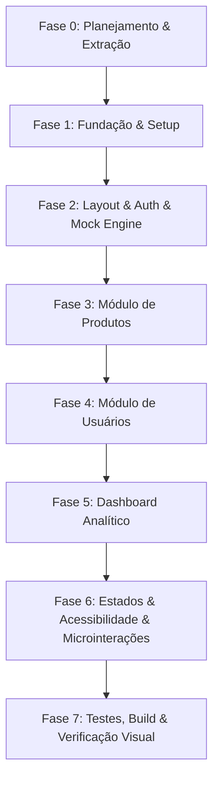

# Plano de Implementação — Nexora ERP Cockpit (Front-end)

Este documento detalha o planejamento arquitetural e a execução faseada do front-end do sistema **Nexora**, um ERP/Cockpit de gestão e controle (produtos, usuários, relatórios de vendas e inventário) baseado no design system e nas telas de alta fidelidade exportadas do Google Stitch.

---

## 1. Análise dos Ativos do Google Stitch (/design/stitch/)

Foram inspecionadas e validadas todas as referências visuais (PNG) e estruturais (HTML) presentes em `design/stitch`:

| Tela / Arquivo | Resolução de Referência | Elementos Centrais Identificados |
| :--- | :--- | :--- |
| **01-dashboard-nexora** (`.png` / `.html`) | 1440x900 (Desktop) | 4 KPIs principais com sparkline e badges, gráfico de linha de vendas diárias (8 cols), gráfico de rosca de estoque por departamento (4 cols), ranking de produtos mais vendidos com barra de progresso, lista de alertas críticos de estoque com ação "Repor", tabela de transações recentes, controle de período (7d/30d/90d/Personalizado). |
| **02-gestao-de-usuarios-nexora** (`.png` / `.html`) | 1440x900 (Desktop) | Faixa de 4 métricas de equipe (Total, Ativos, Administradores, Convites pendentes), toolbar de filtros (Busca, Perfil, Status), tabela com avatars coloridos por inicial, Drawer lateral de 440px com upload de avatar, seleção de perfil em cards detalhados, matriz de permissões por módulo (Dashboard, Produtos, Usuários vs. Ver, Criar, Editar, Excluir) e switches operacionais. |
| **03-produtos-consulta-nexora** (`.png` / `.html`) | 1440x900 (Desktop) | Catálogo de produtos com barra de busca (`⌘K`), filtros de Categoria, Status, Faixa de estoque e Preço com tags ativas removíveis, ordenação, tabela de 8 itens com seleção por checkbox, barra flutuante de ações em lote inferior, Drawer de detalhe (420px) com foto, ficha técnica, margem calculada e histórico de movimentações, e modal de exclusão. |
| **04-novo-produto-nexora** (`.png` / `.html`) | 1440x900 (Desktop) | Formulário em 2 colunas (8/12 e 4/12): Informações Básicas (Nome, SKU com botão Gerar, EAN-13, Categoria, Marca, Descrição técnica com contador de 500 chars), Preço e Custo (Preço, Custo, Margem calculada somente leitura, toggle de desconto PDV), Estoque (Qtd, Mínimo com validação de erro, Unidade, toggle de Alerta). Lateral: Dropzone com slots de imagens, Status (Ativo, Rascunho, Inativo), Live HUD Preview com projeção financeira de estoque. Rodapé fixo de 72px com aviso de modificações e ações. |
| **05-login-nexora** (`.png` / `.html`) | 1440x900 (Desktop) | Tela dividida 40/60. Esquerda: Logo Nexora, formulário com e-mail, senha com show/hide, link esqueci senha, checkbox customizado "Manter conectado", botão primário e botão Google corporativo. Direita: Painel imersivo com dot-grid radial, glow azul atmosférico com animação suave, telemetria de sistema online e mockup do cockpit em perspectiva 3D (CSS perspective/transform). |
| **06-login-erro-validacao-nexora** (`.png` / `.html`) | 1440x900 (Desktop) | Variação com banner de erro semântico (`#F2555A`), campos em estado inválido, mensagens de erro e efeito de shake no formulário. |

### Divergências e Harmonização Arquitetural
1. **Ícones:** Os arquivos exportados usavam *Material Symbols Outlined* via CDN. Substituiremos 100% por **Lucide React** (stroke 1.5px, 20px), garantindo empacotamento local, zero dependências externas e renderização SVG precisa.
2. **Fontes:** Os exports importavam via Google Fonts. No projeto, as fontes (**Manrope**, **Inter**, **JetBrains Mono**) serão instaladas estritamente via pacotes locais `@fontsource/*`, sem chamadas externas.
3. **Tokens de Cores:** Os exports continham classes geradas do Material Theme Builder misturadas com hexadecimais no login. Iremos normalizar todos os tokens nas variáveis CSS do tema Tailwind/shadcn (`--background`, `--surface-1`, `--card`, `--primary`, etc.).
4. **Modal de Exclusão:** A especificação exige uma versão superior à do HTML de export: modal com impacto no histórico, opção "Inativar em vez de excluir", checkbox de confirmação para habilitar botão destrutivo, atualização otimista na tabela e toast de 5s com ação "Desfazer".

---

## 2. Design System & Tokens Semânticos

O tema será estritamente Dark Mode (Deep Midnight / High-Precision Dark), configurado em `src/styles/theme.css` e integrado ao Tailwind:

```css
:root {
  /* Camadas de Superfície */
  --background: #05070D;
  --surface-1: #0A0F1C; /* Sidebar, Topbar, Painéis estruturais */
  --card: #0E1526;      /* Cards operacionais, containers */
  --card-elevated: #141C30; /* Drawers, Modais, Popovers */
  --popover: #141C30;

  /* Bordas e Divisores */
  --border-subtle: #1B2540;
  --border-highlight: #2A3A66;
  --border: #1B2540;
  --input: #1B2540;

  /* Cores de Destaque e Ação */
  --primary: #2F6BFF;
  --primary-hover: #4C82FF;
  --primary-pressed: #1F52D6;
  --primary-glow: rgba(47, 107, 255, 0.35);
  --blue-deep: #0B2A6F;
  --accent-cyan: #38BDF8;

  /* Tipografia & Contrastes */
  --text-primary: #EAF0FF;
  --text-secondary: #9AA8C7;
  --text-muted: #7A89AB;     /* Contraste AA para textos secundários */
  --text-disabled: #5F6E8F;  /* Apenas elementos desativados */

  /* Estados Semânticos (Fundos a 12% de opacidade) */
  --status-success: #34D399;
  --status-success-bg: rgba(52, 211, 153, 0.12);
  --status-warning: #F5B544;
  --status-warning-bg: rgba(245, 181, 68, 0.12);
  --status-error: #F2555A;
  --status-error-bg: rgba(242, 85, 90, 0.12);

  /* Dimensões e Raios */
  --radius-card: 14px;
  --radius-input: 10px;
  --radius-btn: 10px;
  --radius-pill: 9999px;
}
```

- **Tipografia:**
  - `font-headline`: Manrope (Títulos: H1 32/40 bold, H2 24/32 semibold, KPI 28/36 bold)
  - `font-sans`: Inter (Interface e corpo de texto: 14/22 regular e medium)
  - `font-mono`: JetBrains Mono (SKUs, UUIDs, tabelas monetárias com `tabular-nums`)
- **Acessibilidade:** Alvos clicáveis mínimos de 40px, foco `ring-2 ring-primary-hover ring-offset-2 ring-offset-background`.

---

## 3. Arquitetura da Solução e Estrutura de Pastas

```
src/
├── app/
│   ├── router.tsx                # Definição de rotas do React Router
│   ├── providers.tsx             # QueryClientProvider, AuthProvider, TooltipProvider, Toaster
│   └── index.css                 # Import de fontes @fontsource e tokens CSS
├── components/
│   ├── ui/                       # shadcn/ui customizado (Button, Input, Card, Table, Dialog, Sheet, etc.)
│   ├── layout/                   # Sidebar (248px), Topbar (64px), PageHeader, CommandPalette, UserMenu
│   └── feedback/                 # EmptyState, ErrorBoundary, SkeletonLoader, ConfirmDeleteDialog
├── features/
│   ├── auth/                     # LoginPage, AuthContext, LoginForm, BrandShowcaseMockup
│   ├── dashboard/                # DashboardPage, KpiGrid, SalesLineChart, StockDonutChart, TopProducts, CriticalStockAlerts, RecentSalesTable, OnboardingEmptyState
│   ├── products/                 # ProductsListPage, ProductFormPage, ProductDrawer, BatchActionBar, useProducts
│   └── users/                    # UsersListPage, UserDrawer, RoleSelectorCards, PermissionMatrix, useUsers
├── lib/
│   ├── api/                      # client.ts (Axios ou fetch encapsulado com interceptor), authApi, productsApi, usersApi, reportsApi
│   ├── schemas/                  # product.schema.ts, user.schema.ts, auth.schema.ts, report.schema.ts
│   └── utils/                    # formatters.ts (R$, data pt-BR, %, números), cn.ts, skuGenerator.ts
├── mocks/
│   ├── browser.ts                # Inicialização do worker MSW (VITE_USE_MOCKS=true)
│   ├── data/                     # 40 produtos realistas, 12 usuários, histórico de vendas de 90 dias
│   └── handlers/                 # auth.handlers.ts, products.handlers.ts, users.handlers.ts, reports.handlers.ts
├── styles/
│   └── theme.css                 # Tokens CSS centralizados
└── tests/
    ├── unit/                     # Testes de formatadores, schemas Zod, componentes de formulário
    └── e2e/                      # Playwright specs (Login, Cadastro de Produto, Consulta, Exclusão com Desfazer)
docs/
└── API-CONTRACT.md               # Contrato detalhado de endpoints para migração futura para o back-end
```

---

## 4. Camada de Dados, Mocking e Integração Futura

1. **Cliente HTTP Centralizado (`src/lib/api/client.ts`):**
   - Configurado com `baseURL = import.meta.env.VITE_API_URL || '/api'`.
   - Gerencia timeout, headers e respostas padronizadas `ApiResponse<T>`.
   - Interceptor de erro 401 que invalida o contexto de autenticação em memória e redireciona para `/login`.
   - Nenhum componente visual fará chamada de rede direta.
2. **Tipos e Schemas Zod (`src/lib/schemas/`):**
   - Entidades estritas: `ProductSchema`, `UserSchema`, `SaleTransactionSchema`, `DashboardSummarySchema`.
   - Tipos TypeScript inferidos via `z.infer<typeof Schema>`, prontos para desacoplamento quando houver gerador OpenAPI.
3. **Mock Service Worker (MSW v2):**
   - Habilitado condicionalmente por `VITE_USE_MOCKS === 'true'`.
   - Simulação server-side de paginação (`page`, `pageSize`), busca textual (`q`), ordenação (`sort`, `order`) e filtros categóricos.
   - Delay simulado de 300–600ms para exibição orgânica de Skeletons.
   - Suporte a gatilhos de simulação de erro 500 e estado de lista vazia.
4. **TanStack Query v5:**
   - Query Keys determinísticas: `['products', filters]`, `['users', filters]`, `['reports', period]`.
   - Invalidação automática após mutações (`createProduct`, `updateProduct`, `deleteProduct`).
   - Exclusão otimista com reversão no cache caso o usuário clique em "Desfazer" no toast dentro de 5 segundos.
5. **Autenticação Segura:**
   - Sessão controlada por estado em memória (`AuthContext`) e simulação de cookie/sessão; **zero uso de localStorage para armazenar tokens JWT**.

---

## 5. Divisão Detalhada das Fases de Execução

Conforme as diretrizes, a execução será rigorosamente pausada ao final de cada fase para revisão do usuário:



### Fase 1 — Fundação (Setup & Design Tokens)
- Inicializar projeto Vite com template `react-ts` em modo strict.
- Configurar Tailwind CSS de acordo com a documentação oficial atual para Vite.
- Configurar shadcn/ui com os tokens de cores, raios e dimensões exatas do Nexora.
- Instalar pacotes de fontes locais `@fontsource/manrope`, `@fontsource/inter`, `@fontsource/jetbrains-mono`.
- Configurar Lucide React, ESLint e Prettier com scripts no `package.json` (`dev`, `build`, `lint`, `typecheck`, `test`).
- Configurar path alias `@/` em `vite.config.ts` e `tsconfig.json`.
- Configurar `.env.example` com `VITE_API_URL` e `VITE_USE_MOCKS=true`.
- **Critério de parada:** `npm run typecheck` e `npm run lint` rodando com zero erros.

### Fase 2 — Layout Global, Autenticação & Base de Mocking
- Criar a camada de API (`client.ts`), schemas base Zod e configurar MSW com handlers de autenticação.
- Implementar `AuthProvider`, `ProtectedRoute` e simulação de sessão.
- Construir a tela de Login (`/login`) dividida 40/60:
  - Esquerda: formulário com e-mail, senha com show/hide, checkbox "Manter conectado", botão primário e botão Google.
  - Direita: painel com dot-grid radial, luz pulsante azul e mockup do cockpit em perspectiva 3D (CSS puro).
  - Tratamento de erro com banner semântico e animação de shake.
- Construir o Layout Principal autenticado:
  - `Sidebar` fixa de 248px (logo Nexora, rotas com indicador ativo azul translúcido e barra de 3px, rodapé com perfil do usuário e menu popup).
  - `Topbar` fixa de 64px com busca global com atalho `Ctrl K` integrado à `CommandPalette`, sino de notificações e avatar.
  - Responsividade: sidebar recolhível em viewports menores que 1024px.
- Página 404 estilizada com gradiente e atalhos de retorno.
- **Critério de parada:** Login navegando para o layout autenticado, command palette funcional e verificação de tela.

### Fase 3 — Módulo de Produtos (`/produtos`, `/produtos/novo`, `/produtos/:id/editar`)
- Criar schemas e mock data de produtos (40 itens tecnológicos realistas).
- Implementar página `/produtos`:
  - Barra de ferramentas com busca, filtros (Categoria, Status, Faixa de estoque, Preço) com tags removíveis.
  - Tabela TanStack Table (altura de linha 64px, cabeçalho 44px, seleção por checkbox, miniaturas, badges de estoque).
  - Barra flutuante de ações em lote inferior (centralizada).
  - Drawer lateral de 420px com detalhes do produto (foto hero, dados financeiros, margem, auditoria).
  - Paginação com seletor de 8, 16, 32 itens por página.
- Implementar formulário `/produtos/novo` e `/produtos/:id/editar`:
  - Grade 8/12 e 4/12: Informações básicas, SKU com gerador automático, código de barras, descrição com contador de 500 chars.
  - Preço e custo com cálculo automático de margem de lucro e markup somente leitura.
  - Estoque com validação de estoque mínimo vs. quantidade atual.
  - Dropzone de imagens com preview e slots.
  - Live HUD preview calculando valor em estoque e giro.
  - Barra inferior fixa de 72px com aviso de modificações e bloqueio de saída acidental (`useBlocker`).
- Modal de confirmação de exclusão com impacto no inventário, opção de inativação e checkbox de habilitação.
- Toast com botão "Desfazer" (5 segundos) e atualização otimista na tabela.
- **Critério de parada:** Fluxo completo de produto testado e verificado visualmente contra os PNGs do Stitch.

### Fase 4 — Módulo de Usuários (`/usuarios`)
- Criar schemas e mock data de usuários (12 usuários com perfis e avatares variados).
- Implementar página `/usuarios`:
  - Faixa superior de 4 métricas (Total, Ativos, Administradores, Convites pendentes).
  - Toolbar de busca e filtros de Perfil e Status.
  - Tabela de usuários com iniciais coloridas nos avatares, status em badges e menu de ações.
- Implementar Drawer lateral de 440px para cadastro/edição de usuário:
  - Upload de foto de perfil.
  - Campos de nome, e-mail institucional e telefone com máscara.
  - Seletor de Perfil em cards clicáveis (Administrador, Gerente, Vendedor, Estoquista).
  - Matriz interativa de permissões por módulo pré-preenchida dinamicamente conforme o perfil selecionado.
  - Switches de envio de convite por e-mail e exigência de troca de senha no primeiro acesso.
- **Critério de parada:** Drawer de usuários funcional, validação com Zod e verificação visual.

### Fase 5 — Dashboard Analítico (`/`)
- Criar endpoints e mocks de relatórios e resumos operacionais.
- Implementar página `/`:
  - Seletor de período (7 dias, 30 dias, 90 dias, Personalizado) com botão de exportação.
  - Grid de 4 KPIs com contagem animada numérica, sparklines em SVG/Recharts e badges semânticos de variação.
  - Gráfico de linha de alta precisão "Vendas ao longo do tempo" (8 colunas) com Recharts e tooltip customizado dark.
  - Gráfico de rosca "Estoque por categoria" (4 colunas) com centro vazado, métricas totais e legenda tabular detalhada.
  - Lista de "Produtos mais vendidos" com ranking e barras horizontais proporcionais.
  - Lista de "Alertas de estoque crítico" com badges semânticos e botão "Repor".
  - Tabela de "Vendas recentes" com transações detalhadas.
  - Estado vazio com onboarding visual de 3 etapas para contas sem histórico de vendas.
- **Critério de parada:** Dashboard interativo em conformidade com o PNG do Stitch.

### Fase 6 — Estados de Carga, Microinterações, Responsividade & Acessibilidade
- Implementar Skeletons específicos para cada tela (Dashboard, Tabelas, Drawers, Cards).
- Implementar telas de erro (500/offline) com botão de nova tentativa.
- Implementar estados vazios ("Nenhum resultado encontrado") com ação "Limpar filtros".
- Refinar microinterações: transições de hover (150-200ms cubic-bezier), anéis de foco acessíveis, suporte a `prefers-reduced-motion`.
- Ajustar layouts para laptops e tablets (sidebars recolhíveis, grids responsivos).
- Auditoria de acessibilidade (labels de form, ARIA dialogs, contraste AA garantido em #7A89AB e #EAF0FF).
- **Critério de parada:** Todos os 4 estados (loading, sucesso, vazio, erro) funcionando perfeitamente em todas as telas.

### Fase 7 — Qualidade, Testes Automatizados, Build & Contrato de API
- Testes unitários com Vitest + Testing Library: formatadores de moeda/data, schemas Zod, cálculos de margem de produto, componentes de formulário.
- Testes E2E com Playwright: fluxo de Login → Cadastro de Produto → Listagem de Produtos → Exclusão com Desfazer → Visualização no Dashboard.
- Validação estrita: `npm run lint`, `npm run typecheck`, `npm run test` e `npm run build` gerando bundle limpo e sem warnings.
- Inspeção visual final com o navegador do agente comparando capturas de tela 1440x900 com as imagens de referência em `/design/stitch/`.
- Documentação `docs/API-CONTRACT.md` detalhando cada endpoint mockado para facilitar a implementação do back-end futuro.
- **Critério de parada:** Todos os testes passando, build de produção bem-sucedido e walkthrough completo.

---

## 6. Plano de Verificação

### Testes Automatizados
- `npm run lint` — Validação estrita de lint sem erros.
- `npm run typecheck` — TypeScript strict compilando sem erros nem `any`.
- `npm run test` — Bateria de testes unitários com Vitest cobrindo validações e utilitários.
- `npx playwright test` — Testes end-to-end cobrindo os fluxos críticos de negócio.
- `npm run build` — Build de produção do Vite validado.

### Verificação Visual e Manual
- Comparação das capturas em 1440x900 com os PNGs do Stitch usando a ferramenta de navegador do agente.
- Validação das interações: Drawer abrindo e fechando, atalho `Ctrl K`, cálculo em tempo real de margens no cadastro de produto, exclusão com desfazer em 5 segundos.

---

> [!IMPORTANT]
> **Modo de Planejamento Ativo:** Conforme solicitado, nenhum código da aplicação será gerado antes da sua expressa aprovação deste plano. Após sua aprovação, iniciaremos pela **Fase 1** e pausaremos ao final de cada fase para sua revisão.
